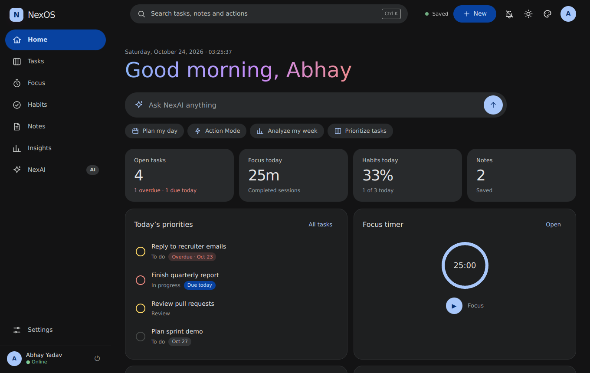
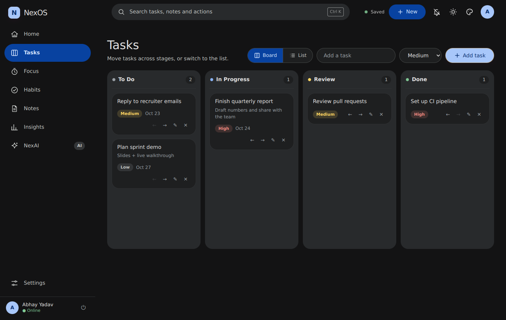
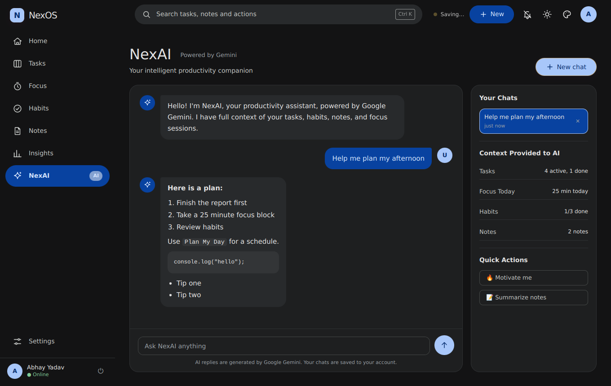
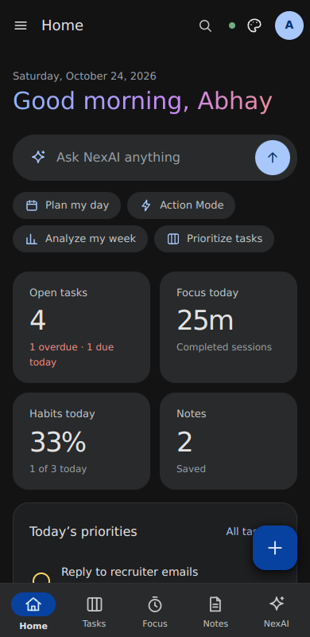

# NexOS: AI Productivity Workspace


NexOS is a web workspace for planning your day and staying focused. It combines a Kanban board, a focus timer, a habit tracker, notes and analytics with NexAI, an assistant powered by Google Gemini that can see your tasks and habits.

**Live demo:** https://ai-aqit.onrender.com
The demo runs on a free server, so the first load can take up to a minute.

I built NexOS alone, using AI as a pair programmer. I wrote this README to explain what the app does and how it is put together.



| Kanban | NexAI | Mobile |
|:---:|:---:|:---:|
|  |  |  |

---

## Features

**Tasks**
- Kanban board with four stages: To Do, In Progress, Review, Done
- Drag and drop on desktop, arrow buttons on phones
- Priority levels, due dates, descriptions, and an AI helper that suggests a description
- **Plan My Day:** builds a schedule from your open tasks and habits, either instantly by priority and due date, or with AI

**Focus**
- Pomodoro timer with focus, short break and long break modes
- Adjustable durations, auto-start for breaks, optional sound
- Daily focus minutes are logged and shown in analytics

**Habits**
- Daily check-ins on a 7-day grid with streak counters
- 12-week heatmap of completed habits

**Notes**
- Tags, pinning, search and filters, word count
- One-click AI summary of a note

**Analytics**
- Focus time (7, 14 or 30 days), task status split, habit completion and a daily productivity score
- Tasks completed per day and a weekly review that compares this week with last week
- Save the weekly review as a note

**NexAI (Google Gemini)**
- Chat with saved history: open, continue and delete past chats
- Each message includes a live snapshot of your tasks, habits, focus time and notes
- Daily AI insight on the dashboard
- **Action Mode:** describe what you want, review the proposed actions (create tasks, update tasks, create notes) and apply only the ones you approve

**General**
- **Guest mode:** try the app without an account. Your data stays in your browser and NexAI is turned off
- Google sign-in, with data saved per user in MongoDB. NexOS only receives your name, email and profile picture
- **Profile panel** (sidebar): change your display name, download all your data (workspace and NexAI chats), delete your account and everything stored for it. In guest mode: download your data or clear guest data on this device
- Global search for tasks and notes (`Ctrl+K`)
- JSON backup and restore
- Browser notifications for tasks due today or overdue (only while the tab is open)
- Starter data and a "Getting started" checklist for new users
- Two designs, **Google** (Material 3) and **Microsoft** (Fluent 2), each in light, dark or match-device themes; responsive layout with a bottom navigation bar on phones
- Keyboard shortcuts: `Alt+1` to `Alt+7` switch views, `Ctrl+K` opens search and commands, `Ctrl+S` saves a note, `?` lists shortcuts, `Esc` closes dialogs

---

## Tech stack

| Layer | Technology |
|---|---|
| Frontend | Vanilla JavaScript, HTML5, CSS3 (no framework, no build step) |
| Charts | Chart.js 4 |
| Backend | Node.js 18+, Express 4 |
| Database | MongoDB Atlas with Mongoose |
| Authentication | Google Sign-In (Google Cloud), JWT in an httpOnly cookie |
| AI | Google Gemini API, called from the server only |
| Security | Helmet (CSP), CORS allow-list, express-rate-limit |
| Hosting | Render |

---

## How it works

```
Browser (HTML, CSS, JS)
   |
   |  /api/auth, /api/state, /api/chat, /api/chats, /api/complete
   v
Express server  --->  MongoDB Atlas (users, saved state, chats)
   |
   +-->  Google Gemini API (the API key never leaves the server)
```

- **State:** tasks, habits, notes and timer logs are saved as one JSON document per user and synced after every change. The browser keeps a local copy as a backup if the network fails.
- **Chats:** every NexAI conversation is saved in its own MongoDB collection. A message and its reply are only saved if the AI call succeeds.
- **AI reliability:** the server retries once on temporary Gemini errors, can switch to a second model, and shows a clear message to the user when the quota is used up.
- **Limits:** AI requests are limited per signed-in user (30 per minute, 500 per day), so one user cannot use up the quota for everyone.
- **Safe rendering:** user and AI text is escaped before it is placed in the page.

---

## Run it locally

You need Node.js 18 or newer, a MongoDB Atlas database, a Google OAuth client ID and a Gemini API key.

```bash
git clone https://github.com/abhayyadav0090/AI.git
cd AI
npm install
cp .env.example .env     # then fill in the values
npm run dev
```

Open http://localhost:3000

### Environment variables

| Name | Required | Where to get it |
|---|---|---|
| `MONGO_URI` | Yes | MongoDB Atlas, Connect, Drivers. Put the database name `nexos` before the `?` |
| `GOOGLE_CLIENT_ID` | Yes | Google Cloud Console, APIs & Services, Credentials, OAuth client ID (Web) |
| `GEMINI_API_KEY` | Yes | https://aistudio.google.com/apikey |
| `JWT_SECRET` | Yes | Any long random string |
| `ALLOWED_ORIGINS` | Yes | Your site address, for example `http://localhost:3000` |
| `GEMINI_MODEL` | No | Model name. Defaults to the one set in `server.js` |
| `GEMINI_FALLBACK_MODEL` | No | A second model to use when the first is busy or over quota |
| `PORT` | No | Defaults to 3000 |

Setup notes:
- In Google Cloud Console, add your site address and `http://localhost:3000` under **Authorized JavaScript origins**.
- In MongoDB Atlas, open **Network Access**. Free hosting has no fixed IP address, so you need to allow `0.0.0.0/0`. Use a strong database password.
- Never commit your `.env` file. It is already listed in `.gitignore`.

---

## Deploy on Render

1. Push the project to GitHub.
2. On Render, choose **New**, then **Blueprint** (it reads `render.yaml`), or create a **Web Service** with build command `npm install` and start command `npm start`.
3. Add the environment variables from the table above.
4. After the first deploy, add the Render address to **Authorized JavaScript origins** in Google Cloud Console and to `ALLOWED_ORIGINS`.

---

## Project structure

```
.
├── public/
│   ├── index.html       # Page structure and dialogs
│   ├── style.css        # Base layout and component styles
│   ├── design.css       # Google and Microsoft designs, light and dark tokens
│   ├── ui.js            # Appearance, toasts with Undo, New menu, task list view, sync status
│   ├── app.js           # Frontend logic: tasks, timer, habits, notes, analytics, NexAI
│   ├── manifest.json
│   └── favicon.svg
├── server.js            # Express server: auth, state, chats, Gemini proxy
├── render.yaml          # Render blueprint
├── API.md               # API reference
├── ARCHITECTURE.md      # Design notes
└── package.json
```

---

## API overview

All routes start with `/api`. Everything except `config`, `health` and `auth` needs a signed-in user. Details and error codes are in [API.md](API.md).

| Method | Route | Purpose |
|---|---|---|
| GET | `/api/health` | Server status |
| GET | `/api/config` | Public settings for the sign-in button |
| POST | `/api/auth/google` | Sign in with a Google credential |
| POST | `/api/auth/logout` | Sign out |
| GET | `/api/me` | Current user |
| PUT | `/api/me` | Change the display name (`{ name }`) |
| DELETE | `/api/me` | Delete the NexOS workspace data (body `{ confirm: "DELETE" }`) |
| GET, PUT | `/api/state` | Load and save the user's workspace data |
| POST | `/api/chat` | Send a message to NexAI and save the chat |
| GET | `/api/chats`, `/api/chats/:id` | List and open saved chats |
| DELETE | `/api/chats/:id` | Delete a chat |
| POST | `/api/complete` | One-off AI prompt (insights, summaries) |

---

## Privacy

NexOS does not use advertising or tracking scripts. In guest mode nothing leaves your browser. When you sign in with Google, the app stores your name, email, profile picture and workspace data in MongoDB Atlas, and AI requests are sent to the Google Gemini API. Read the full details at [/privacy.html](public/privacy.html).

---

## Known limits

- The free Render server sleeps when idle, so the first request can be slow.
- The free Gemini quota is small. When it runs out, NexAI shows a "busy" message until it resets.
- Due-date notifications only work while NexOS is open in a browser tab, and many mobile browsers do not show them.
- There are no automated tests yet.

---

## License

Released under the MIT License.


## Legacy URL redirects
This server supports generic exact-path redirects configured through `LEGACY_REDIRECTS_JSON`. Configure redirects in Render environment variables when a legacy path needs to point elsewhere.


The delete-workspace action removes NexOS chats, workspace state, and NexOS push subscriptions. It intentionally retains the shared Google identity record so independently deployed apps using the same identity collection do not lose access to their own records.


## Daily task reminder time (2.0.1)

Signed-in users can choose a daily task reminder time from the clock control beside the notification bell. The preference is saved separately in MongoDB and applies to both in-app due notifications and server push reminders, using India Standard Time (Asia/Kolkata). The default is 09:00. The background push scheduler polls every five minutes, so delivery is approximate rather than exact to the minute. A sleeping Render Free instance may delay background reminders until it wakes.


## Editorial visual refresh (2.1.0)

NexOS now uses a shared Ice Silver (`#DDE3E8`), Deep Aubergine (`#3A0F34`) and Marigold (`#FAA000`) design system across the dashboard, task board, habits, notes, analytics, focus timer and sign-in experience. Light and dark themes each define their full surface, text, border, overlay and chart tokens; the theme button, browser theme color, SVG gradients and analytics charts refresh when the theme changes. Existing account data, reminder time and reminder ON/OFF preferences remain separate from visual theme styling.


## Dashboard quick actions (2.1.1)
The Dashboard now provides Plan My Day, Ask NexAI, and NexAI Action Mode together. Action Mode still drafts proposed changes for explicit review before anything is applied. Theme-specific control and Analytics chart colors have also been improved for light/dark consistency.


## Design, features and fixes (2.2.0)
See `RELEASE-NOTES-2.2.0.md`. Highlights: Google and Microsoft designs you can switch in Settings, a home screen with an ask-NexAI box, a command palette (`Ctrl+K`), task list view, undo for deletes, notes that autosave, offline-friendly sign-in, per-user reminder time zones, and a set of bug fixes in the server and the app.
