# NexOS: AI Productivity Workspace

    

NexOS is a web workspace for planning your day and staying focused. It combines a Kanban board, focus timer, habit tracker, notes and analytics with **NexAI**, an assistant powered by Google Gemini that can work with your tasks, habits, focus activity and notes.

**Current source release: 3.3.4.** The 3.x series focuses on performance, mobile usability, reliable navigation and a more capable NexAI experience while preserving existing NexOS features and workspace data.

**Live demo:** [https://ai-aqit.onrender.com](https://ai-aqit.onrender.com)

The demo runs on a free server, so its first load after inactivity can take up to a minute.

NexOS is developed independently, with AI used as a pair-programming tool.

**Classic**

| Google design | Apple design |
|:---:|:---:|
| 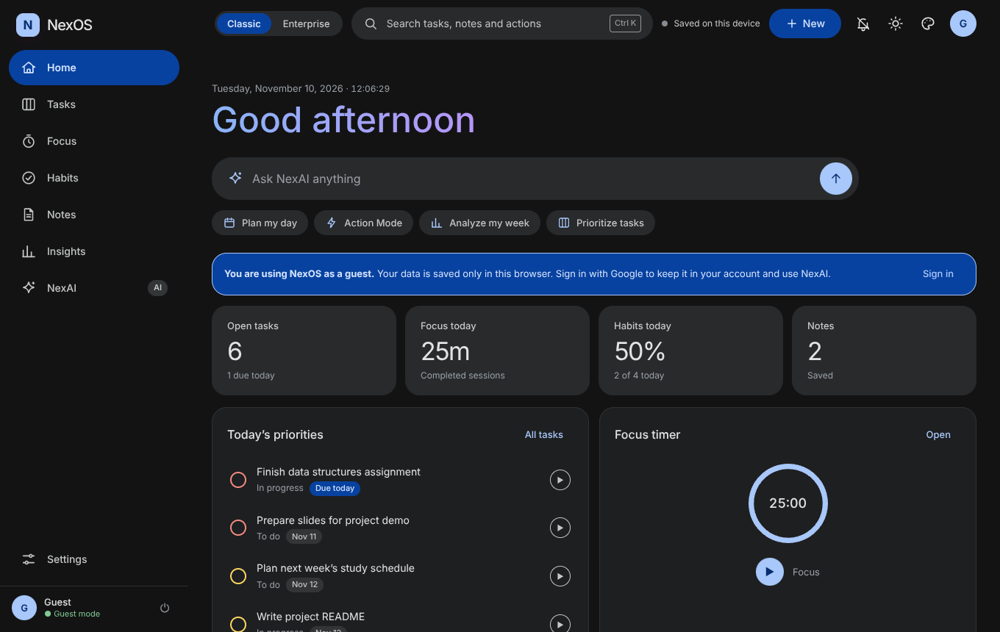 | 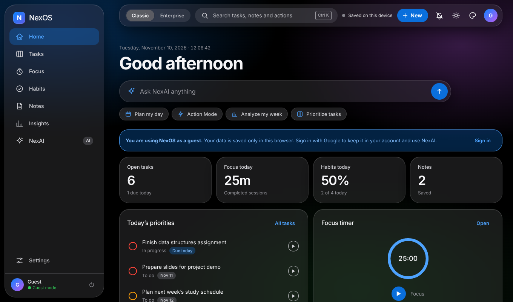 |

**Enterprise**

| Dashboard | Apple Glass theme |
|:---:|:---:|
| 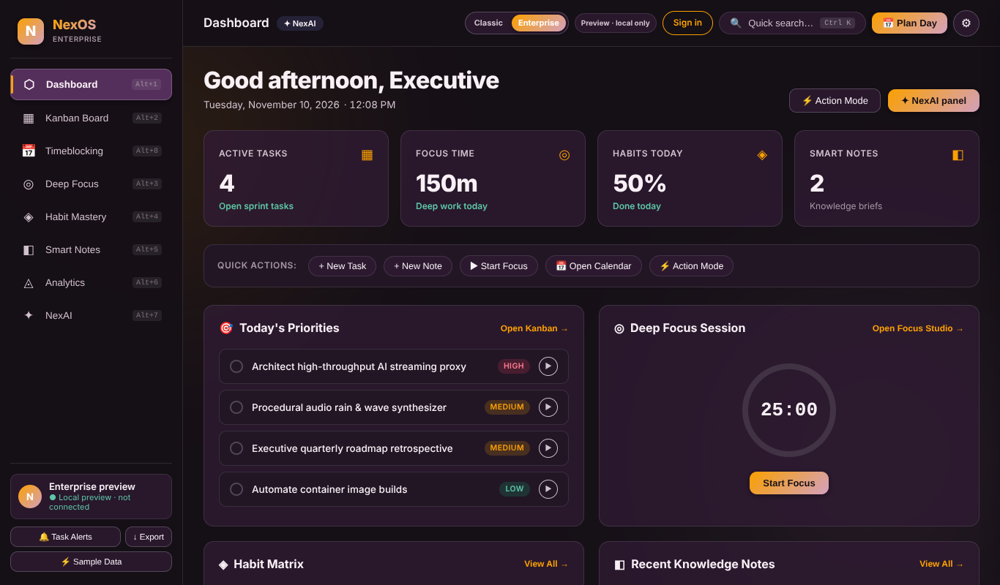 | 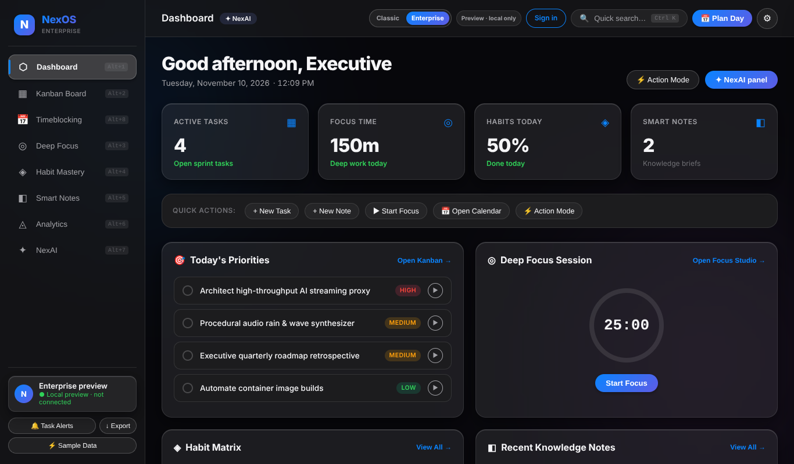 |

**Tasks and NexAI**

| Kanban | NexAI |
|:---:|:---:|
| 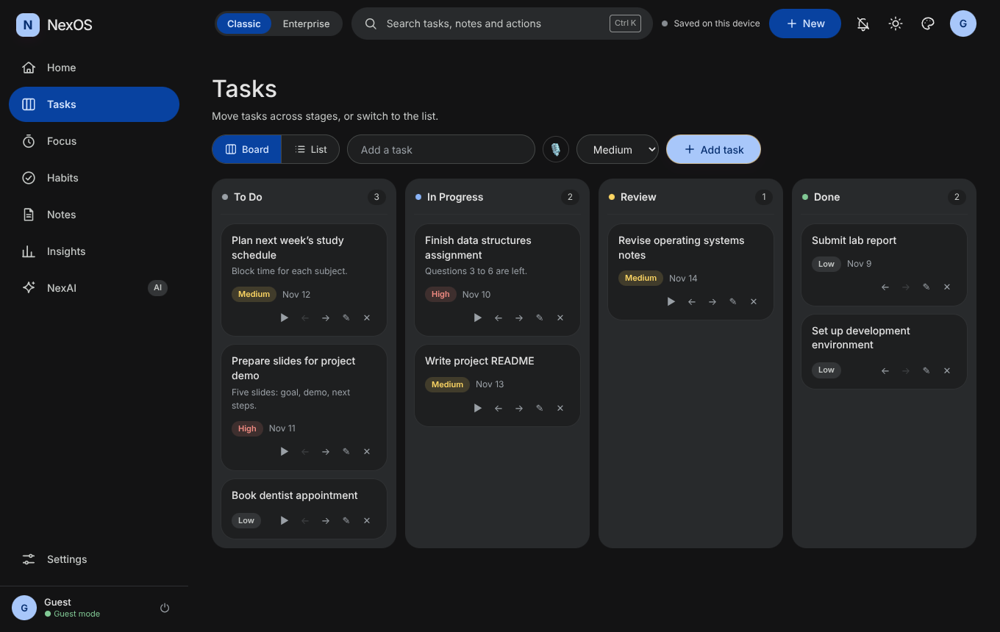 | 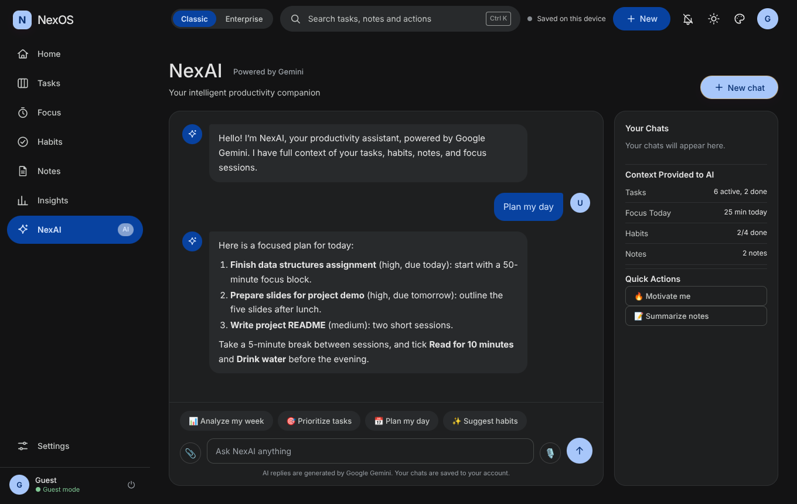 |

**On a phone**

| Classic, Google design | Classic, Apple design | Enterprise |
|:---:|:---:|:---:|
| 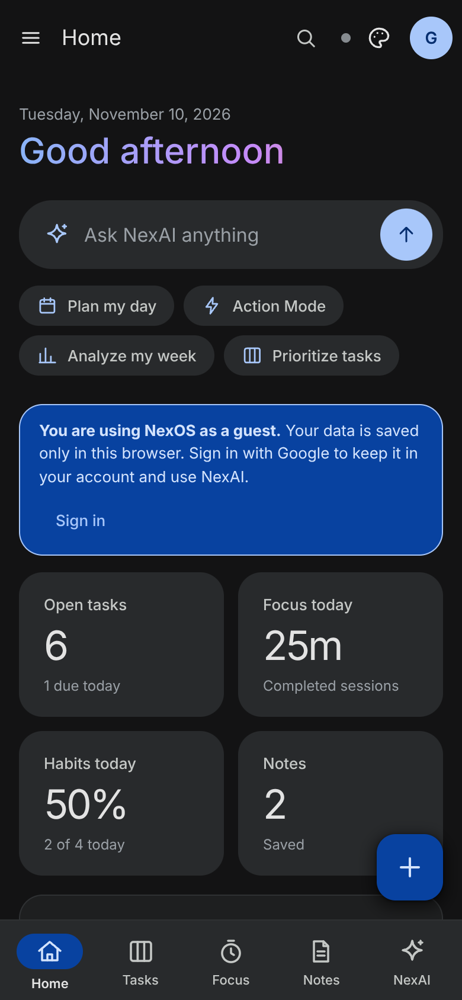 | 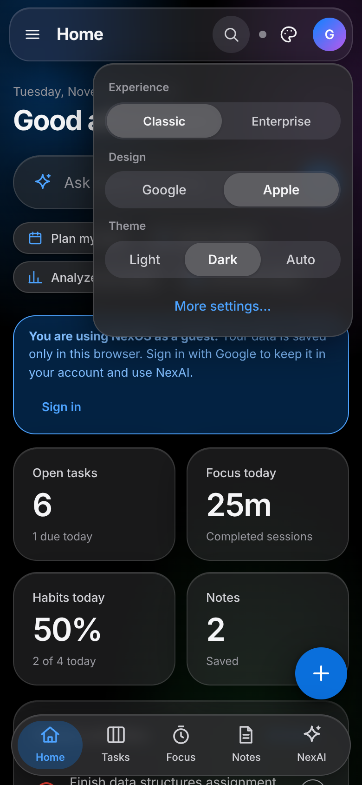 | 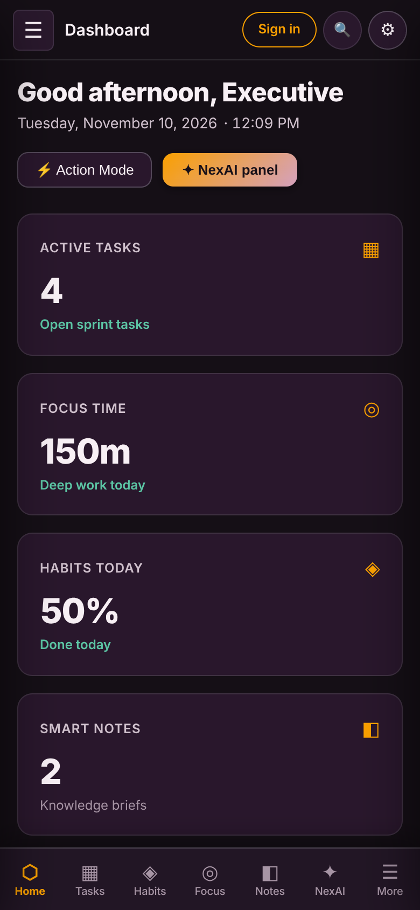 |

**NexAI, voice and Recently deleted on a phone**

| Classic NexAI | Enterprise NexAI: file attached, mic beside it | Action Mode with a mic | Recently deleted |
|:---:|:---:|:---:|:---:|
| 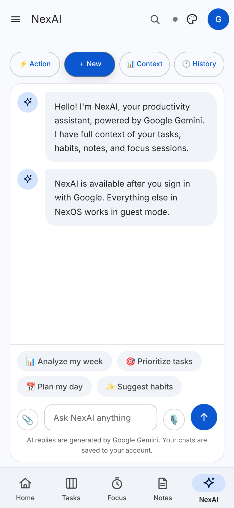 | 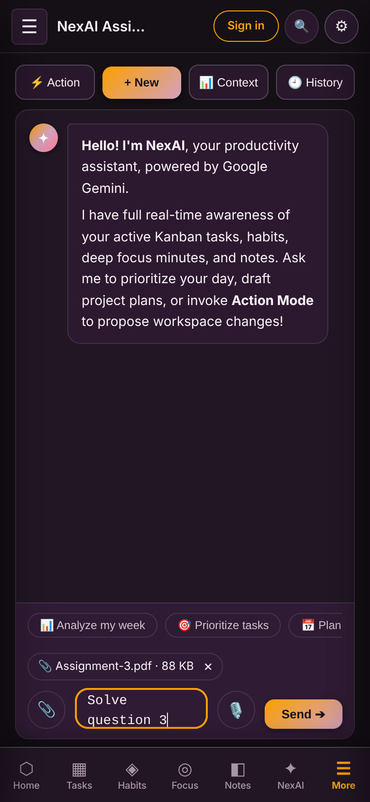 | 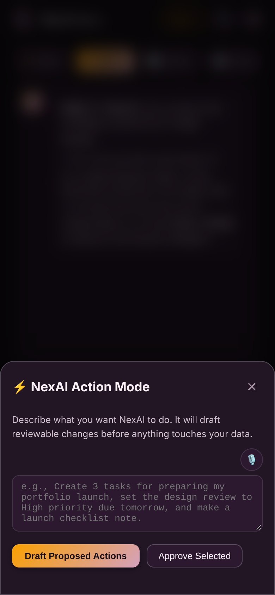 | 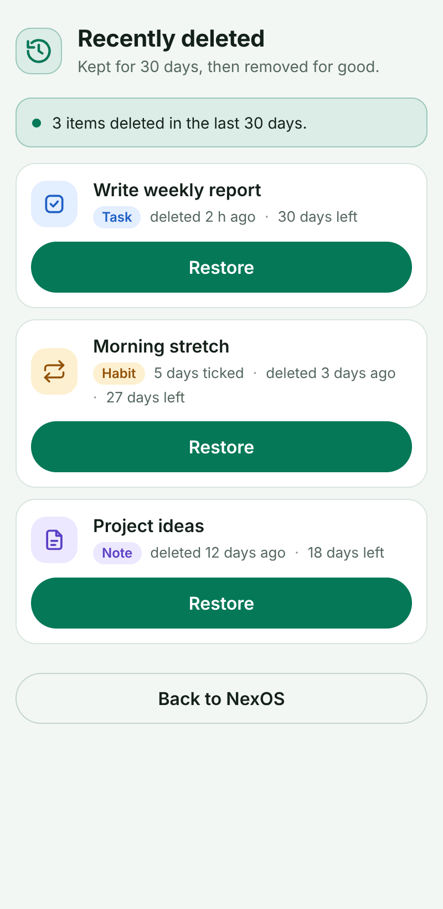 |

*All screenshots were taken in guest mode with sample data, not a real account. The NexAI conversation in the Classic desktop screenshot is an example written for this README, and the phone NexAI screenshots show the guest sign-in prompt.*

---

## Features

### Classic and Enterprise

- Two experiences on one account and one set of data. **Classic** (`/` and `/classic`) is the simple, focused version. **Enterprise** (`/enterprise`, also `/redesign`) adds a timeblocking calendar, a focus studio with ambient sound, a richer Kanban board, analytics and a NexAI side panel.
- Switch between them from the Classic | Enterprise control in the top bar or the quick appearance menu.
- Enterprise has six themes: Apple Glass, Material, Apple Light, M3, Overgame (the default) and Cobalt Lime.

### Tasks

- Kanban board with four stages: To Do, In Progress, Review and Done.
- Drag and drop on desktop; arrow controls on phones.
- Priority levels, due dates and descriptions.
- AI helper for suggesting task descriptions.
- **Plan My Day:** build a schedule from open tasks and habits, either by priority and due date or with AI.

### Focus

- Pomodoro timer with focus, short-break and long-break modes.
- Adjustable durations, optional automatic break start and sound.
- Daily focus minutes are logged and shown in analytics.
- **Focus on a task:** each open task has a play button that moves it to In Progress and starts a focus session. When the session ends, NexOS asks whether the task is done.

### Habits

- Daily check-ins on a 7-day grid with streak counters.
- 12-week completion heatmap.

### Notes

- Tags, pinning, search, filters and word count.
- One-click AI summary of a note.

### Analytics

- Focus time over 7, 14 or 30 days, task status split, habit completion and daily productivity score.
- Tasks completed per day and a weekly review comparing this week with last week.
- Save the weekly review as a note.

### Reminders and recovery

- Task reminders for due and overdue tasks can be turned on or off. The daily reminder time is configurable (default 09:00, India Standard Time) and applies to in-app notifications and background Web Push alerts.
- **Recently deleted:** deleted tasks, habits and notes (in Enterprise, tasks and habits) are kept in your account for 30 days, up to 30 items, and can be restored from any device. This is the Recovery Center page.

### NexAI (Google Gemini)

- Chat with saved history: open, continue and delete past conversations.
- Each message can use a current snapshot of workspace information, including tasks, habits, focus time and notes.
- Daily AI insight on the dashboard.
- **Action Mode:** describe a goal, review proposed actions (such as creating tasks, updating tasks or creating notes), and apply only the actions you approve.
- **Voice input (3.2.0):** dictate messages, Action Mode instructions and supported task fields in Classic and Enterprise. Where available, the microphone language can be switched between English (India) and Hindi. Dictation fills the input; it does not automatically submit the message or approve an action.
- **File analysis (3.3.0):** attach up to 3 supported files, with a combined limit of 6 MB, to a main NexAI chat in Classic or Enterprise. Supported types include PDF, PNG, JPG, WEBP and supported text/code files such as TXT, MD, CSV, PY, JS and JAVA. NexAI can describe images, summarise documents and help solve assignments step by step.
- On mobile, the attachment picker can offer camera and gallery options where the browser supports them.
- Uploaded files are validated by the server and are processed for the request rather than kept as permanent workspace files. If sending fails, the draft message and selected files remain available for retry.
- **3.3.1 mobile layout:** the NexAI mobile interface groups Action Mode, New Chat, Workspace Context and Past Conversations into compact controls. Context and history open in a sheet so the chat can use more of the available screen height. Desktop layout remains unchanged by this mobile-specific adjustment.
- **3.3.1 dictation reliability:** speech recognition results are rebuilt from the current recognition session instead of blindly appending every browser result. This prevents repeated words when a browser sends progressively longer recognition results and preserves multiple phrases returned in one event.

### General

- **Guest mode:** try the app without an account. Guest data stays in the browser and NexAI is disabled.
- Google sign-in, with workspace data saved per user in MongoDB. NexOS receives the Google profile information needed for the account, such as name, email and profile picture.
- **Profile panel:** change the display name, download workspace and NexAI data, or delete the account and its NexOS data. In guest mode, download or clear the guest data on that device.
- Global search for tasks and notes (`Ctrl+K`).
- JSON backup and restore.
- Browser notifications for tasks due today or overdue (while the app is open; push reminders may also be configured separately).
- Starter data and a Getting Started checklist for new users.
- Two designs: **Google** (Material 3) and **Apple** (liquid glass), each with light, dark or match-device themes.
- **Quick-start:** a new workspace asks once what you will use NexOS for (study and exams, projects and sprints, daily routine and habits, or just exploring). The answer sets the starter data, the default focus timer and the order of the dashboard cards.
- Responsive layouts with bottom navigation on phones.
- Installable web app: a service worker caches the app shell for faster startup. API responses are not cached as app-shell content.
- A privacy page at `/privacy.html`.
- Keyboard shortcuts: `Alt+1` to `Alt+7` switch Classic views, `Ctrl+K` opens search and commands, `Ctrl+S` saves a note, `?` lists shortcuts and `Esc` closes dialogs. Enterprise also supports `Alt+1` to `Alt+8` for its views and `Ctrl+\` to toggle the NexAI panel.

---

## Tech stack

| Layer | Technology |
|---|---|
| Frontend | Vanilla JavaScript, HTML5 and CSS3; no frontend framework or build step |
| Charts | Chart.js 4 |
| Backend | Node.js 18+, Express 4 |
| Database | MongoDB Atlas with Mongoose |
| Authentication | Google Sign-In, with JWT in an httpOnly cookie |
| AI | Google Gemini API, called from the server |
| Security | Helmet (CSP), CORS allow-list and express-rate-limit |
| Hosting | Render |

---

## How it works

```text
Browser (HTML, CSS, JavaScript)
   |
   |  /api/auth, /api/bootstrap, /api/state, /api/chat, /api/chats, /api/complete
   v
Express server  --->  MongoDB Atlas (users, saved state, chats)
   |
   +--> Google Gemini API (the API key stays on the server)
```

- **State:** tasks, habits, notes and timer logs are saved as one JSON document per user and synchronised after changes. The browser keeps a local copy to help protect against network interruptions.
- **Startup:** Classic and Enterprise can use `/api/bootstrap` to load account information and workspace data together, reducing separate startup requests.
- **Chats:** NexAI conversations are saved in MongoDB. A message and its reply are saved only when the AI call succeeds.
- **AI reliability:** the server can retry temporary Gemini failures and switch to a configured fallback model. NexOS shows a clear message when the available quota is exhausted.
- **Limits:** AI requests are rate-limited per signed-in user, at 30 per minute and 500 per day (set in `server.js`).
- **File handling:** supported attachments are checked by the server, subject to the chat upload limits, and are not retained as permanent user files.
- **Safe rendering:** user and AI text is escaped before it is placed in the page.

For detailed technical information, see [ARCHITECTURE.md](mds/ARCHITECTURE.md).

---

## Run it locally

You need Node.js 18 or newer, a MongoDB Atlas database, a Google OAuth client ID and a Gemini API key.

```bash
git clone https://github.com/abhayyadav0090/AI.git
cd AI
npm install
cp .env.example .env
# Fill in the values in .env
npm run dev
```

Open [http://localhost:3000](http://localhost:3000).

### Environment variables

| Name | Required | Where to get it |
|---|---|---|
| `MONGO_URI` | Yes | MongoDB Atlas connection string. Use the `nexos` database name before the query string. |
| `GOOGLE_CLIENT_ID` | Yes | Google Cloud Console → APIs & Services → Credentials → OAuth client ID (Web) |
| `GEMINI_API_KEY` | Yes | [Google AI Studio](https://aistudio.google.com/apikey) |
| `JWT_SECRET` | Yes | A long, random secret string |
| `ALLOWED_ORIGINS` | Yes | Comma-separated site origins (scheme, host and port, no path), for example `https://your-app.onrender.com,http://localhost:3000`. The app's own host is always allowed. |
| `GEMINI_MODEL` | No | Model name; defaults to the value configured by the server. |
| `GEMINI_FALLBACK_MODEL` | No | Second model used when the primary model is unavailable or over quota. |
| `PORT` | No | Defaults to `3000`. |
| `NODE_ENV` | No | `development` for local use, `production` on a server. |
| `VAPID_PUBLIC_KEY`, `VAPID_PRIVATE_KEY` | No | Needed only for push reminders. Create the pair with `node scripts/generate-vapid-keys.js`. |
| `VAPID_SUBJECT` | No | Contact for push services, for example `mailto:you@example.com`. |
| `LEGACY_REDIRECTS_JSON` | No | Exact-path redirects for old URLs; see Server notes below. |

Setup notes:

- In Google Cloud Console, add your site and `http://localhost:3000` under **Authorised JavaScript origins**.
- In MongoDB Atlas, create a database user under **Database Access** with read and write access to the `nexos` database, and use that user and password in `MONGO_URI`. If the password contains characters such as `@`, `:`, `/` or `#`, URL-encode them (for example `@` becomes `%40`).
- NexOS only needs the database name (`nexos`) before the query string; the `?retryWrites=true&w=majority` suffix that Atlas adds to its connection string can stay.
- In MongoDB Atlas, configure Network Access for your hosting environment. If using `0.0.0.0/0`, understand that it allows connections from any IP; use a strong database password and appropriate database permissions.
- Never commit `.env`; it should remain excluded by `.gitignore`.

---

## Troubleshooting

| What you see | Likely cause | What to do |
|---|---|---|
| Sign-in screen says "Google sign-in is not set up on the server (GOOGLE_CLIENT_ID is missing)" | `GOOGLE_CLIENT_ID` is empty on the server | Set it in `.env` or in Render, then restart or redeploy. |
| The Google button does not appear, or Google says the origin is not allowed | Your site's address is missing from **Authorised JavaScript origins** | Add the exact address (for example `https://your-app.onrender.com`) and `http://localhost:3000` in Google Cloud Console. |
| "Sign-in is not set up on the server" after choosing an account | `JWT_SECRET` is not set | Set a long random value and restart. |
| "This origin is not allowed to use the NexOS API." (403) | The page's origin is not in `ALLOWED_ORIGINS` | Add the exact origin, with no path or trailing slash. |
| The server starts but never reaches MongoDB | Wrong `MONGO_URI`, a database user without access to `nexos`, an IP that is not allowed, or a password with special characters that is not URL-encoded | Check all four in Atlas (Database Access and Network Access) and read the server log for the connection error. |
| NexAI says it is busy or the quota is used up | The Gemini quota is exhausted | Wait and try again, or set `GEMINI_FALLBACK_MODEL`. |
| A file is rejected as unsupported or too large | Unsupported type, more than 3 files or more than 6 MB in total | Use PDF, PNG, JPG, WEBP or a text/code file, and export Word files to PDF. |
| "Background task alerts are not configured on the server yet." | The `VAPID_*` variables are missing | Run `node scripts/generate-vapid-keys.js`, set the three `VAPID_*` variables and redeploy. |
| The first load takes up to a minute on Render | The free instance was asleep | Wait for it to wake up. |

## Deploy on Render

1. Push the project to GitHub.
2. In Render, choose **New → Blueprint** to use `render.yaml`, or create a **Web Service** with build command `npm install` and start command `npm start`.
3. Add the environment variables listed above.
4. After the first deploy, add the Render address to **Authorised JavaScript origins** in Google Cloud Console and to `ALLOWED_ORIGINS`.
5. Before releasing, run `npm test` on the complete merged project and verify the deployed app in the target desktop and mobile browsers.

### Other ways to deploy

- **Docker:** `Dockerfile` builds the app on Node 20 Alpine. `docker-compose.yml` runs it on port 3000 with a health check at `/api/health`. It passes only the core variables, so add the `VAPID_*` variables to the file if you want push reminders.
- **Nginx:** `docker-compose.yml` also defines an optional Nginx service, started with `docker-compose --profile production up` and configured by `nginx.docker.conf`. `nginx.conf` is an example production config for a server with Nginx and Certbot SSL.
- **Vercel:** `vercel.json` sends every request to `server.js` through `@vercel/node` and includes the `public` folder.

---

## Project structure

```text
.
├── public/
│   ├── index.html              # Classic page structure and dialogs
│   ├── index-redesign.html     # Enterprise experience (served at /enterprise)
│   ├── style.css               # Classic base layout and component styles
│   ├── design.css              # Google and Apple designs, light/dark tokens
│   ├── ui.js                   # Shared UI interactions and Classic controls
│   ├── app.js                  # Tasks, timer, habits, notes, analytics and NexAI
│   ├── attach.js               # NexAI attachment-picker/client handling
│   ├── push-client.js          # Browser side of push reminders
│   ├── sw.js                   # Service worker (app-shell cache)
│   ├── recover.html            # Recovery Center (Recently deleted)
│   ├── privacy.html            # Privacy page
│   ├── manifest.json           # Web app manifest
│   ├── favicon.svg
│   ├── nexos-icon-192.png
│   └── nexos-icon-512.png
├── lib/
│   └── attachments.js          # Server-side file validation for NexAI chat
├── scripts/                    # generate-vapid-keys.js and the regression tests run by npm test
├── mds/
│   ├── API.md                  # API reference
│   ├── ARCHITECTURE.md         # Architecture, security and scaling notes
│   └── DEPLOY-NEXOS-3.0.0.md   # Original 3.0.0 deployment guide
├── docs/
│   └── screenshots/            # Images used in this README
├── RELEASE-NOTES/
│   ├── RELEASE-NOTES NexOS 1.0/
│   ├── RELEASE-NOTES NexOS 2.0/
│   └── RELEASE-NOTES NexOS 3.0/
├── server.js                   # Express server: auth, state, chats and Gemini proxy
├── render.yaml                 # Render blueprint
├── Dockerfile                  # Container image (Node 20 Alpine)
├── docker-compose.yml          # App container, optional Nginx service
├── nginx.conf                  # Example Nginx production config
├── nginx.docker.conf           # Nginx config used by Docker Compose
├── vercel.json                 # Vercel routing
├── .env.example                # Template for environment variables
├── .gitignore
├── .dockerignore
├── package.json
├── package-lock.json
├── LICENSE
└── README.md
```

---

## API overview

All routes start with `/api`. Authentication is required for workspace and chat data routes; public configuration, health and authentication endpoints are exceptions. See [API.md](mds/API.md) for request shapes and error codes.

| Method | Route | Purpose |
|---|---|---|
| GET | `/api/health` | Server status |
| GET | `/api/config` | Public settings for the sign-in button |
| POST | `/api/auth/google` | Sign in with a Google credential |
| POST | `/api/auth/logout` | Sign out |
| GET | `/api/me` | Current user |
| GET | `/api/bootstrap` | Load account information and workspace data together |
| PUT | `/api/me` | Change the display name (`{ name }`) |
| DELETE | `/api/me` | Delete NexOS workspace data (body `{ confirm: "DELETE" }`) |
| GET, PUT | `/api/state` | Load and save workspace data |
| POST | `/api/chat` | Send a NexAI message, optionally with supported attachments, and save the chat |
| GET | `/api/chats`, `/api/chats/:id` | List and open saved chats |
| DELETE | `/api/chats/:id` | Delete a chat |
| POST | `/api/complete` | One-off AI prompt (insights, summaries) |
| GET | `/api/push/config` | Public key the browser needs to subscribe to push reminders |
| GET, PUT | `/api/push/preferences` | Load and save reminder preferences (on/off, time, time zone) |
| POST, DELETE | `/api/push/subscribe` | Subscribe or unsubscribe this browser from push reminders |
| POST | `/api/push/test` | Send a test push notification |

---

## Security notes

- **Sign-in:** the server verifies the Google credential, then issues a JWT valid for 7 days in a cookie named `token`. The cookie is `httpOnly`, `SameSite=Lax`, and `Secure` in production or on HTTPS requests. Deleting a workspace invalidates cookies that were issued before it.
- **API origin check:** requests from another origin are refused with `403` unless the origin is in `ALLOWED_ORIGINS`. `trust proxy` is set to `1` for Render.
- **Rate limits:** 600 requests per 15 minutes per IP on `/api`, plus the per-user AI limits above. The counters live in server memory.
- **Content Security Policy** (set with Helmet in `server.js`):

| Directive | Allowed sources |
|---|---|
| `default-src`, `worker-src`, `manifest-src` | `'self'` |
| `script-src` | `'self'`, `'unsafe-inline'`, `cdn.jsdelivr.net`, `accounts.google.com` |
| `script-src-attr` | `'unsafe-inline'` |
| `style-src` | `'self'`, `'unsafe-inline'`, `fonts.googleapis.com`, `fonts.gstatic.com`, `accounts.google.com` |
| `font-src` | `'self'`, `fonts.googleapis.com`, `fonts.gstatic.com` |
| `connect-src` | `'self'`, `generativelanguage.googleapis.com`, `cdn.jsdelivr.net`, `accounts.google.com` |
| `img-src` | `'self'`, `data:`, `blob:`, `https:` |
| `frame-src` | `'self'`, `accounts.google.com` |

- **Adding an external script, style, font, image or API host:** add it to the matching directive in the `helmet` block near the top of `server.js`. Otherwise the browser blocks it, and the only sign is an error in the browser console.
- **Known weakness:** the policy allows inline scripts and inline event handlers (`'unsafe-inline'`), because the pages use them. That limits what the policy can stop, so NexOS also escapes user and AI text before showing it. The Gemini address in `connect-src` is allowed, but the browser does not call Gemini directly, so it is a candidate for removal. A stricter policy is planned as a separate release; see "Security hardening plan" in [ARCHITECTURE.md](mds/ARCHITECTURE.md).

---

## Privacy

NexOS does not use advertising or tracking scripts. In guest mode, workspace data stays in the browser and NexAI is disabled. When signed in with Google, NexOS stores account and workspace information in MongoDB Atlas. AI requests are sent to the Google Gemini API. Uploaded files are processed for the relevant NexAI request and are not kept as permanent workspace files. See [Privacy](https://ai-aqit.onrender.com/privacy.html) for the full details.

---

## Known limits

- The free Render server sleeps when idle, so the first request can be slow.
- The free Gemini quota is limited. When it runs out, NexAI may show a busy or quota message until capacity becomes available again.
- Due-date browser notifications depend on browser support and generally require NexOS to remain open. Background push delivery can be delayed if the hosting instance sleeps.
- Voice input depends on the browser's speech-recognition support and microphone permission. Support and language availability vary by browser and device; test the target phones and browsers before relying on it.
- File uploads are limited to 3 files and 6 MB combined per message. Supported files include PDF, PNG, JPG, WEBP and supported text/code formats. **DOCX is not currently supported; export Word documents to PDF first.**
- File attachments are available in the main NexAI chat. The Enterprise side-panel chat does not provide the same attachment control unless separately added.
- Files are not retained as permanent chat attachments. To ask follow-up questions about a file later, attach it again.
- Automated script checks do not replace real browser, microphone, camera, mobile-layout or end-to-end Gemini testing.
- Rate limits are kept in server memory, so they reset when the server restarts and are not shared between instances.
- Each user's workspace is saved as one document (a save request is limited to 2 MB), and reminder checks run from a timer inside the server process every five minutes. That fits a single instance; read the scaling notes in [ARCHITECTURE.md](mds/ARCHITECTURE.md) before running more than one.

---

## Server notes

**Legacy URL redirects.** The server supports generic exact-path redirects configured through `LEGACY_REDIRECTS_JSON`. Configure redirects in Render environment variables when a legacy path needs to point elsewhere.

The delete-workspace action removes NexOS chats, workspace state and NexOS push subscriptions. It intentionally retains the shared Google identity record so independently deployed apps using the same identity collection do not lose access to their own records.

---

## License

Released under the MIT License.

---

## Release history

One line per release. The linked notes have the details.

### NexOS 1.x

- **1.0** — Front-end only: Kanban board, to-do list and focus timer. [Notes](RELEASE-NOTES/RELEASE-NOTES%20NexOS%201.0/RELEASE-NOTES-1.0.md)
- **1.1** — Google sign-in and NexAI added. [Notes](RELEASE-NOTES/RELEASE-NOTES%20NexOS%201.0/RELEASE-NOTES-1.1.md)

### NexOS 2.x

- **2.0.1** — Daily task reminder time. [Notes](RELEASE-NOTES/RELEASE-NOTES%20NexOS%202.0/RELEASE-NOTES-2.0.1.md)
- **2.0.2** — Task reminders can be turned on or off. [Notes](RELEASE-NOTES/RELEASE-NOTES%20NexOS%202.0/RELEASE-NOTES-2.0.2.md)
- **2.1.0** — Editorial visual refresh (Ice Silver, Deep Aubergine, Marigold). [Notes](RELEASE-NOTES/RELEASE-NOTES%20NexOS%202.0/RELEASE-NOTES-2.1.0.md)
- **2.1.1** — Dashboard quick actions: Plan My Day, Ask NexAI, Action Mode. [Notes](RELEASE-NOTES/RELEASE-NOTES%20NexOS%202.0/RELEASE-NOTES-2.1.1.md)
- **2.2.0** — Google and Microsoft designs, command palette, undo for deletes, autosaving notes. [Notes](RELEASE-NOTES/RELEASE-NOTES%20NexOS%202.0/RELEASE-NOTES-2.2.0.md)
- **2.2.1** — Action Mode can be cancelled; clearer account-deletion text. [Notes](RELEASE-NOTES/RELEASE-NOTES%20NexOS%202.0/RELEASE-NOTES-2.2.1.md)
- **2.3.0** — Classic and Enterprise experiences on one account. [Notes](RELEASE-NOTES/RELEASE-NOTES%20NexOS%202.0/RELEASE-NOTES-2.3.0.md)
- **2.3.1** — Enterprise-first routing and Overgame as the default theme. [Notes](RELEASE-NOTES/RELEASE-NOTES%20NexOS%202.0/RELEASE-NOTES-2.3.1.md)
- **2.3.2** — Cloud reliability work merged, with per-user reminder time zones. [Notes](RELEASE-NOTES/RELEASE-NOTES%20NexOS%202.0/RELEASE-NOTES-2.3.2.md)
- **2.4.0** — Enterprise gets a calendar, focus studio, richer board and NexAI panel. [Notes](RELEASE-NOTES/RELEASE-NOTES%20NexOS%202.0/RELEASE-NOTES-2.4.0.md)
- **2.4.1** — Chat-not-found and greeting fixes. [Notes](RELEASE-NOTES/RELEASE-NOTES%20NexOS%202.0/RELEASE-NOTES-2.4.1.md)
- **2.4.2** — Classic | Enterprise switch in the appearance menu. [Notes](RELEASE-NOTES/RELEASE-NOTES%20NexOS%202.0/RELEASE-NOTES-2.4.2.md)
- **2.5.0** — Apple design replaces Microsoft. [Notes](RELEASE-NOTES/RELEASE-NOTES%20NexOS%202.0/RELEASE-NOTES-2.5.0.md)
- **2.5.1** — Phone menu fixes for Enterprise. [Notes](RELEASE-NOTES/RELEASE-NOTES%20NexOS%202.0/RELEASE-NOTES-2.5.1.md)
- **2.5.2** — Safer habit deletes with undo. [Notes](RELEASE-NOTES/RELEASE-NOTES%20NexOS%202.0/RELEASE-NOTES-2.5.2.md)
- **2.5.3** — Recently deleted, kept for 30 days. [Notes](RELEASE-NOTES/RELEASE-NOTES%20NexOS%202.0/RELEASE-NOTES-2.5.3.md)
- **2.5.4** — Quick-start goal picker for new workspaces. [Notes](RELEASE-NOTES/RELEASE-NOTES%20NexOS%202.0/RELEASE-NOTES-2.5.4.md)
- **2.5.5** — Quick-start on Enterprise, with a Your setup picker. [Notes](RELEASE-NOTES/RELEASE-NOTES%20NexOS%202.0/RELEASE-NOTES-2.5.5.md)
- **2.5.6** — Quick-start no longer brings back deleted starter items. [Notes](RELEASE-NOTES/RELEASE-NOTES%20NexOS%202.0/RELEASE-NOTES-2.5.6.md)
- **2.5.7** — Better first day, including insight in guest mode. [Notes](RELEASE-NOTES/RELEASE-NOTES%20NexOS%202.0/RELEASE-NOTES-2.5.7.md)
- **2.5.8** — Focus on a task from its play button. [Notes](RELEASE-NOTES/RELEASE-NOTES%20NexOS%202.0/RELEASE-NOTES-2.5.8.md)
- **2.5.9** — A shorter Settings page. [Notes](RELEASE-NOTES/RELEASE-NOTES%20NexOS%202.0/RELEASE-NOTES-2.5.9.md)
- **2.6.0** — Settings sections open on laptops. [Notes](RELEASE-NOTES/RELEASE-NOTES%20NexOS%202.0/RELEASE-NOTES-2.6.0.md)

### NexOS 3.x

- **3.0.0** — Performance foundation: one startup request and leaner reads. [Notes](RELEASE-NOTES/RELEASE-NOTES%20NexOS%203.0/RELEASE-NOTES-3.0.0.md)
- **3.0.1** — Cache-first startup and lighter mobile effects. [Notes](RELEASE-NOTES/RELEASE-NOTES%20NexOS%203.0/RELEASE-NOTES-3.0.1.md)
- **3.0.2** — Scroll fixes for dialogs and views. [Notes](RELEASE-NOTES/RELEASE-NOTES%20NexOS%203.0/RELEASE-NOTES-3.0.2.md)
- **3.0.3** — Recovery Center redesign. [Notes](RELEASE-NOTES/RELEASE-NOTES%20NexOS%203.0/RELEASE-NOTES-3.0.3.md)
- **3.1.0** — Cobalt Lime theme for Enterprise. [Notes](RELEASE-NOTES/RELEASE-NOTES%20NexOS%203.0/RELEASE-NOTES-3.1.0.md)
- **3.1.1** — Faster PWA startup. [Notes](RELEASE-NOTES/RELEASE-NOTES%20NexOS%203.0/RELEASE-NOTES-3.1.1.md)
- **3.2.0** — Voice input for NexAI chat, Action Mode and Add Task. [Notes](RELEASE-NOTES/RELEASE-NOTES%20NexOS%203.0/RELEASE-NOTES-3.2.0.md)
- **3.3.0** — File upload for NexAI (PDF, images, text/code). [Notes](RELEASE-NOTES/RELEASE-NOTES%20NexOS%203.0/RELEASE-NOTES-3.3.0.md)
- **3.3.1** — NexAI mobile layout and repeated-word dictation fix. [Notes](RELEASE-NOTES/RELEASE-NOTES%20NexOS%203.0/RELEASE-NOTES-3.3.1.md)
- **3.3.2** — Mobile voice and send reliability. [Notes](RELEASE-NOTES/RELEASE-NOTES%20NexOS%203.0/RELEASE-NOTES-3.3.2.md)
- **3.3.3** — Enterprise NexAI page fits the phone screen; keyboard stays closed after dictation. [Notes](RELEASE-NOTES/RELEASE-NOTES%20NexOS%203.0/RELEASE-NOTES-3.3.3.md)
- **3.3.4** — Classic NexAI page fits the phone screen. [Notes](RELEASE-NOTES/RELEASE-NOTES%20NexOS%203.0/RELEASE-NOTES-3.3.4.md)

---

## Release checks

Before publishing a release:

1. Keep the version consistent in `package.json`, `package-lock.json`, README, release notes, changelog and version-related tests.
2. Run `npm test` on the complete merged project.
3. Test Classic and Enterprise on desktop and mobile, including Google and Apple designs.
4. Test microphone permission, long dictation, multiple recognition results and language switching on supported browsers.
5. Test attachments with valid and invalid file types, the 3-file/6-MB limits, failed uploads and image analysis.
6. Confirm Recovery Center has not changed unless the release explicitly targets it.
