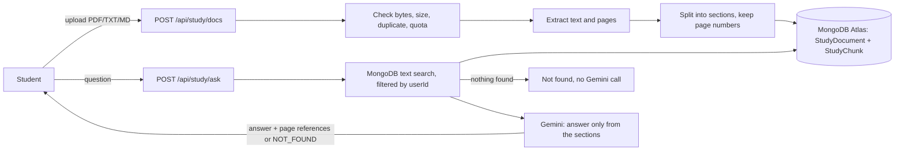

# NexOS — Architecture & Design Decisions

Updated for NexOS 4.1.2. This document describes what the code does today. For request and response shapes see [API.md](API.md).

## System overview

```text
Browser
  Classic     index.html + style.css + design.css + ui.js + app.js + attach.js
  Enterprise  index-redesign.html (own inline script) + attach.js
  Shared      sw.js (service worker), push-client.js, recover.html, privacy.html
        |
        |  HTTPS, JSON, httpOnly cookie
        v
Express server (server.js, lib/attachments.js, lib/study.js)
        |                       |                        |
        v                       v                        v
MongoDB Atlas           Google Gemini API        Browser push services
(users, workspace,      (key stays on the        (Web Push, VAPID keys)
 chats, push data,       server)
 study sections)
```

There is no build step and no frontend framework. Classic and Enterprise are two interfaces over the same account and the same saved workspace.

## Frontend

### Two experiences
- **Classic** (`/`, `/classic`): `index.html`, with Soft and Glass designs (tokens in `design.css`, each with light, dark and auto themes).
- **Enterprise** (`/enterprise`): `index-redesign.html` with five themes chosen through `data-theme` and the `nexos_enterprise_theme` setting. It reads and writes the same saved workspace through a mapping layer (see `scripts/test-enterprise-bridge.js`).

### State and rendering
Classic keeps one `state` object: `tasks`, `habits`, `notes`, `pomodoroLog`, `pomodoroStats`, `dailyPlan`, `trash`, `dueNotificationsSeen`, `theme`, `design`, `currentNoteId`, `seeded`, `hideGuide`, `usedAI` and `profile`.

Every module follows **state → render → event**: an event handler changes `state`, calls `saveState()`, then calls the matching `render*()` function, which rewrites its part of the page.

Persistence:
- **Guest:** the browser only (`localStorage`). NexAI is disabled.
- **Signed in:** a local copy for fast first paint, synchronised to the server with `PUT /api/state`. Startup uses `GET /api/bootstrap` (identity and workspace in one request).

### Service worker and installability
`sw.js` caches the Classic app shell (cache name `nexos-shell-vN`, bumped every release) so the installed app starts quickly. Versioned assets (`?v=x.y.z`) are cached immutably by the server; `/enterprise` and other pages are fetched from the network first; `/api/*` requests are never cached as app-shell content.

### Voice and attachments
- **Voice (3.2.0):** the browser's speech recognition fills the input. Results are merged without repeating, and nothing is submitted automatically.
- **Day derailed and the guest sample (4.0.0):** `derail.js` is shared by Classic and Enterprise. It draws its own dialog and talks to each page through a small adapter (`getTasks`, `applyMoves`, `askAI`, `isGuest`, `signIn`, `toast`). Day derailed sends open tasks due today or earlier (title, priority, stage, date, at most 20) in one `/api/complete` request, keeps only proposals that name task IDs it supplied (at most 8), and after approval changes only the due date to tomorrow. Guests and Enterprise preview never reach the AI: they see scripted sample proposals that save nothing.
- **Study Studio (4.1.0):** `study.js` is shared by Classic and Enterprise and draws its own dialog (upload form, document list with delete, a scope selector and the tutor conversation). Each page passes an adapter (`isGuest`, `signIn`, `toast`). It reads the chosen file in the browser as base64, calls the `/api/study` routes, escapes all text before showing it (only `**bold**` and `` `code` `` become tags) and lists the cited sources under each answer. Guests see a scripted sample and make no request. The conversation lives in memory while the dialog is open; nothing from it is saved.
- **Attachments (3.3.0):** `attach.js` picks files, shrinks large photos on the device and sends base64 data with the chat message (see below).

## Backend

### Routes and limits
See [API.md](API.md). Body limit: 2 MB for every route, 9 MB for `POST /api/chat` and 6 MB for `POST /api/study/docs`, applied after login and rate limits (both skip the small parser in `server.js` and use their own inside the route). Rate limits: 600 requests per 15 minutes per IP on `/api`; AI routes also allow 30 per minute and 500 per day per signed-in user.

### Data model
| Collection | Holds | Indexes |
|---|---|---|
| `User` | Google id, email, name, picture, session cut-off date | `googleId` (unique) |
| `UserState` | The user's whole workspace as one document | `userId` (unique) |
| `Chat` | Title and up to 200 messages (`role`, `content`, `ts`); up to 100 chats per user | `{ userId, updatedAt: -1 }` |
| `PushSubscription` | Browser push subscription | `endpoint` (unique), `userId`, `{ userId, updatedAt: -1 }` |
| `PushPreference` | Reminder time, on/off, time zone | `userId` (unique) |
| `StudyDocument` (4.1.0) | One uploaded study file: title, subject, file name, type, size, page count, section count, content hash | `{ userId, createdAt: -1 }`, `{ userId, contentHash }` (unique, catches duplicates) |
| `StudyChunk` (4.1.0) | One section of a document: `userId`, `documentId`, order, page (or none), heading, text | `{ userId, documentId, idx }`, and a text index `{ userId, text, heading }` so a search stays inside one user's sections |

### NexAI flow
1. The browser builds a context summary from the workspace and sends the message, with attachments if any, to `POST /api/chat`.
2. The server loads the chat, takes the latest 40 messages as history and calls Gemini with the server-side key. It retries a temporary failure and can switch to `GEMINI_FALLBACK_MODEL`.
3. Only if the call succeeds, the message and reply are saved. A failure leaves the chat unchanged.
4. **Action Mode** asks for proposed changes and applies only the ones the user approves.

### Attachments
`lib/attachments.js` accepts up to 3 files and 6 MB in total. It identifies each file by its content (PDF, PNG, JPEG and WEBP signatures; text and code files by extension with no binary bytes), cuts text at 60,000 characters and sends the files to Gemini with that one message. File bytes are never saved; the chat keeps the message and file names. File text is treated as data, not as instructions.

### Study Studio (4.1.0)
`lib/study.js` holds the whole feature on the server: file checks, text extraction, chunking, the Mongoose models and the router mounted at `/api/study`.



- **Upload:** one JSON request with the file as base64 (up to 4 MB, 6 MB body). The file type comes from the real bytes: text PDFs are read with `pdfjs-dist`, TXT and Markdown as UTF-8. Scanned PDFs have no text and are refused with a clear message. The file is read inside the request, one file at a time (a second upload at the same moment gets `STUDY_BUSY`), so a restart can never leave a half-processed document behind. The original file is never stored, only its text sections.
- **Chunking:** sections of up to 1,200 characters that never cross a page, so the page number is exact. Markdown headings are kept with their sections. TXT and Markdown have no page numbers.
- **Retrieval:** a MongoDB text index, not embeddings. This needs no vector index, no extra Gemini quota and no embedding-model choice, so it works on the free Atlas tier with nothing to configure. The trade-off is that it matches words, not meaning, so a question that shares no words with the notes can report "not found". Embeddings and Atlas Vector Search are the planned upgrade if that proves too limiting.
- **Isolation:** every route filters by the `userId` from the login cookie; the text index starts with `userId` so a search cannot leave one user's sections. A document id from another user answers `404`.
- **Tutor prompt:** the best 6 sections are numbered and sent to Gemini with an instruction to answer only from them, treat them as data (not instructions), cite them like `[1]`, and reply `NOT_FOUND` when they are not enough. The server turns `NOT_FOUND`, or no matching section at all, into the same "not found in your material" answer. A follow-up question that is very short borrows words from the previous question for the search.
- **Limits:** 20 documents and 1,500 sections per user, 300 PDF pages and 600,000 characters per file, 12 uploads per hour per user. Asking uses the same per-user AI limits as chat. Deleting a document removes its sections first; deleting the workspace (`DELETE /api/me`) removes all of the user's study data.
- **Storage estimate:** a section is about 1.2 KB of text plus index entries, so a user at the 1,500-section cap uses a few MB. That is small next to the 500 MB free Atlas limit, but it is an estimate: check the collection sizes in Atlas after real use.
- **Security note:** `pdfjs-dist` 3.11 is pinned because it still ships a CommonJS build. Versions before 4.2.67 have a published advisory about running script from a crafted font when a PDF is rendered; NexOS only extracts text and creates the document with `isEvalSupported: false`, which is the documented mitigation. Moving to a current pdf.js is a good follow-up.

### Reminders
A timer inside the server process runs every five minutes, finds users whose reminder time has arrived in their own time zone and sends Web Push messages. Push needs the three `VAPID_*` variables.

## Security model

- **API key:** the Gemini key lives only on the server.
- **Sign-in:** the server verifies the Google credential and issues a 7-day JWT in an `httpOnly`, `SameSite=Lax` cookie, `Secure` in production or on HTTPS. Deleting a workspace invalidates earlier cookies.
- **Origin check:** other origins get `403` unless listed in `ALLOWED_ORIGINS`.
- **CSP:** set with Helmet; the full list is in the README's Security notes.
- **Output escaping:** user and AI text is escaped (`escHtml`) before it is placed in the page.
- **Attachments:** validated by content on the server, limited by count and size, never stored.

### Security hardening plan (planned, not implemented)
The current CSP allows inline scripts and inline event handlers (`'unsafe-inline'`). A stricter policy would be shipped as its own release, so it can be reverted on its own:
1. List every inline `<script>` block and inline event handler in `index.html`, `index-redesign.html` and `recover.html`.
2. Move the handlers to `addEventListener`, and put each remaining inline script under a nonce or hash.
3. Remove `'unsafe-inline'` from `script-src` and `script-src-attr`, then look at `style-src`.
4. Remove the Gemini address from `connect-src` once nothing in the browser calls it, and review `img-src https:`.
5. Check the effective header in browser DevTools and test Google sign-in, Chart.js loading, the service worker, push, attachments, both designs and both experiences.
6. Add a regression test that fails if `'unsafe-inline'` comes back.

## Performance decisions

**3.0.0**
- **One startup request:** `GET /api/bootstrap` returns identity and workspace together.
- **Lean reads:** authentication and workspace reads use Mongoose `lean()`; workspace reads select only `data`.
- **On-demand charts:** Chart.js loads the first time Analytics opens.
- **Scoped observers:** mutation observers watch dialog roots, not the whole document.
- **Asset caching:** versioned CSS and JS use immutable caching; HTML uses a short cache lifetime.
- **Reduced background work:** the Enterprise clock refreshes every 15 seconds, and independent startup requests run concurrently.

**Later**
- **3.0.1:** account-scoped cache-first startup and lighter mobile effects.
- **3.1.1:** cache-first app shell, deferred Classic scripts and correct semantic-version cache headers.
- **3.3.3 and 3.3.4:** the phone NexAI page is sized from the real space between the top bar and the bottom nav, so the page itself does not scroll.
- **4.1.0:** Study Studio adds `study.js`, which the service worker precaches (cache `nexos-shell-v31`). Uploads are read in one request without a queue, and the search is a text-index query filtered by user, so asking costs one database search plus one Gemini call.
- **3.4.x to 4.0.0:** streaming chat replies, retry then fallback model, look-back through the whole chat on request, Enterprise theme cards, chat buttons that add tasks, habits and notes, and `derail.js` (see the release notes). The service worker now precaches `derail.js`.

No load tests or benchmarks have been run, so NexOS makes no throughput claims. Measure in the deployed browser with DevTools Performance and Network panels.

## Scaling notes

Current design: one server instance, one MongoDB database, no cache layer such as Redis (none is needed at this scale).

- **Indexes:** every read is by `userId`, `googleId` or `endpoint`, and all three are indexed (table above). Listing chats uses the compound index.
- **Workspace size:** each user's workspace is one document. A save request is limited to 2 MB, and a MongoDB document is limited to 16 MB. A very large workspace would need splitting into several documents.
- **Chats:** capped at 200 messages per chat and 100 chats per user.
- **Study sections:** stored in their own collections (never in the workspace document), capped at 1,500 per user. Reading a PDF uses server memory for that one file; the 4 MB file limit and one-at-a-time reading are there for a small free instance.
- **Rate limits** use the default in-memory store: they reset on restart and are per instance. With more than one instance, use a shared store.
- **Reminders** run from an in-process timer, and each sweep reads the distinct users with a subscription. With more than one instance, run the timer on one instance only (or move it to a separate worker) so reminders are not sent twice.
- **Sessions** are stateless JWTs, so they work across instances.
- **Render Free** sleeps when idle, so the first request can take up to a minute and reminders can be delayed.

## Design system

- **Classic:** two designs, **Soft** (rounded and tonal) and **Glass** (liquid glass), each with light, dark or match-device themes. Colours, spacing and shapes are tokens in `design.css`.
- **Enterprise:** five themes: Glass, Daylight, Ember (default), Cobalt Lime and Violet Orchid, chosen from preview cards. Older Midnight and Tonal saves open as Glass and Daylight.
- **Motion:** transitions use `transform` and `opacity`, and heavy visual effects are reduced on phones.
